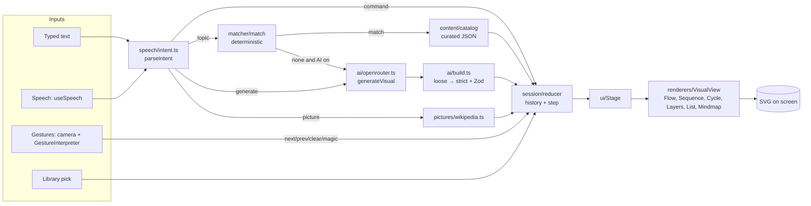
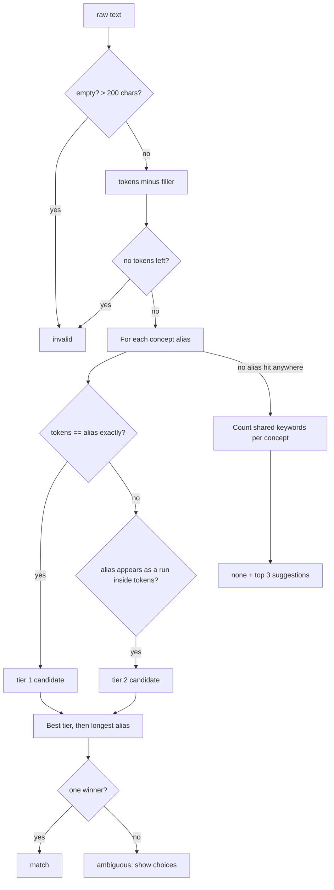
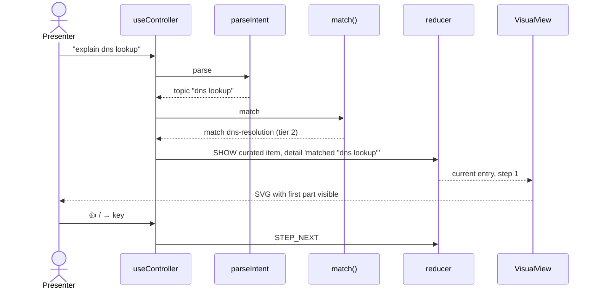
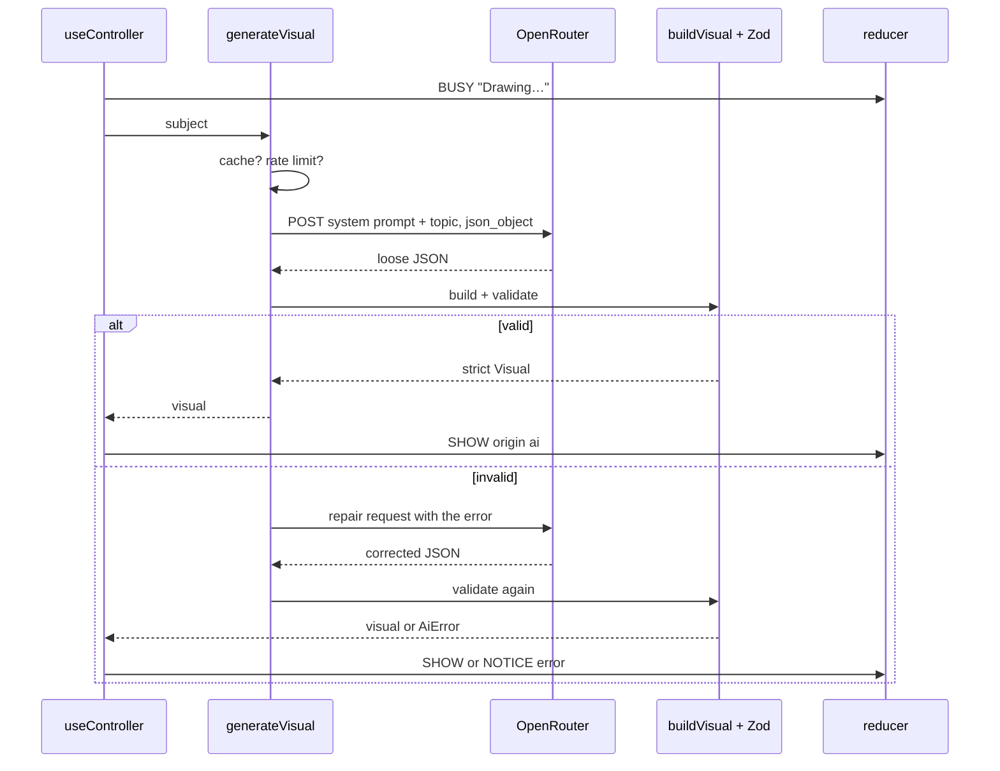
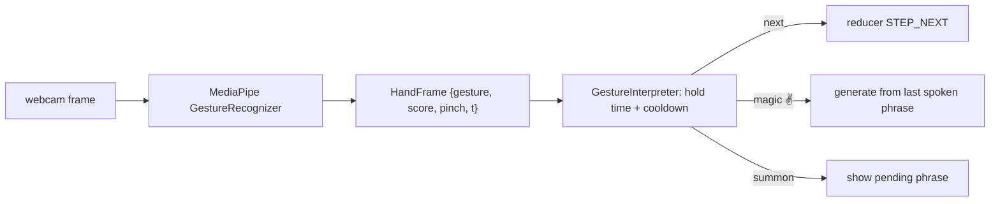

# Flow & Magic: the complete guide

For someone who knows **HTML, CSS, JavaScript and Python**. This project adds **TypeScript, React, Vite, Zod, SVG,
the Web Speech API, MediaPipe (camera hand/face tracking), an LLM API (OpenRouter) and automated testing**.
Each is explained from zero and tied to real files. The `docs/` folder has the formal specs; this guide is the
friendly "understand everything and defend it in an interview" version.

---

## Table of contents

1. [The project in one minute](#1-the-project-in-one-minute)
2. [The tech stack, explained from zero](#2-the-tech-stack-explained-from-zero)
3. [Architecture: the pipeline](#3-architecture-the-pipeline)
4. [The core idea: descriptor-first visuals](#4-the-core-idea-descriptor-first-visuals)
5. [Module-by-module tour](#5-module-by-module-tour)
6. [Main flows with diagrams](#6-main-flows-with-diagrams)
7. [Testing](#7-testing)
8. [Decisions and why](#8-decisions-and-why)
9. [Honest weaknesses and fixes](#9-honest-weaknesses-and-fixes)
10. [Build it yourself from scratch](#10-build-it-yourself-from-scratch)
11. [Change requests you might get](#11-change-requests-you-might-get)
12. [Interview and recruiter questions](#12-interview-and-recruiter-questions)
13. [Glossary](#13-glossary)
14. [Self-check exercises](#14-self-check-exercises)

---

## 1. The project in one minute

**Problem:** When you explain something technical (TCP handshake, CI/CD, the water cycle) on a call, you either draw badly or switch to slides you prepared earlier.

**Solution:** A browser app where you **type, speak or gesture**, and the right **animated diagram** appears. You step through it part by part,
go back, clear it, or ask AI to draw a new one. Present mode gives a clean full-screen view you can share in Zoom/Meet/Teams.

Inputs:

- **Typed:** "explain dns lookup".
- **Speech:** the browser listens; phrases become intents ("next", "show me a flowchart of photosynthesis").
- **Gestures:** webcam + MediaPipe: 👍 next step, 👎 previous, ✋ hold to clear, ✌️ ask AI to draw what you just said, pinch-and-spread to summon.

Outputs: SVG diagrams of six types (flow, sequence, cycle, layers, list, mindmap) and Wikipedia pictures.

**Elevator pitch:**

> "Flow & Magic turns what a presenter says into a validated diagram on screen. Inputs go through a pure intent parser and a
> deterministic matcher against 12 curated concepts. If nothing matches, an optional LLM call returns a loose JSON shape, which
> I convert into a strict descriptor and validate with the same Zod schema the curated content uses. Nothing generated is ever
> executed; my own SVG renderers draw the data. State is a pure reducer with history, and the pure modules are unit-tested."

---

## 2. The tech stack, explained from zero

### 2.1 TypeScript

JavaScript plus types. `strict` mode is on, so the compiler catches many mistakes.

```ts
type Command = 'next' | 'prev' | 'all';          // a union: only these three strings
interface Picture { title: string; imageUrl: string; }
function show(p: Picture): void { ... }
```

**Discriminated unions** are used everywhere here:

```ts
type MatchResult =
  | { status: 'match'; conceptId: string; tier: 1 | 2 }
  | { status: 'ambiguous'; candidates: string[] }
  | { status: 'none'; suggestions: string[] };
```

`status` tells TypeScript which shape you have, so `if (r.status === 'match') r.conceptId` is safe. It is like a Python `Enum` plus data.

### 2.2 React

A library for building UIs from **components**: functions that return HTML-like **JSX**.

```tsx
function Hello({ name }: { name: string }) {
  const [count, setCount] = useState(0);              // state: when it changes, React re-renders
  return <button onClick={() => setCount(count + 1)}>{name}: {count}</button>;
}
```

Hooks used here:

- `useState`: a value that triggers re-render when set.
- `useReducer`: state managed by a **reducer** function `(state, event) => newState`. Used for the whole session.
- `useEffect`: run code after render (start camera, subscribe to speech) and clean up.
- `useRef`: keep a value across renders without re-rendering (the video element, timers).
- **Custom hooks** (`useSpeech`, `useCamera`, `useController`) bundle logic so components stay simple.

React compares the new JSX with the old and updates only what changed in the real DOM.

### 2.3 Vite

The dev server and build tool. `npm run dev` starts a fast local server with hot reload. `npm run build` bundles and minifies into `dist/`.

### 2.4 Zod

A library to **validate data at runtime**. TypeScript types disappear when code runs, so data from JSON files or an AI cannot be trusted by types alone.

```ts
const item = z.object({ label: z.string().min(1).max(80) });
item.parse({ label: 'Hi' });     // OK, returns typed data
item.parse({ label: 42 });       // throws with a clear error
type Item = z.infer<typeof item>; // the TypeScript type, derived from the schema
```

One schema gives you both the **type** and the **runtime check**. `src/domain/schema.ts` defines every visual type this way.

### 2.5 SVG

Scalable Vector Graphics: shapes written as XML tags inside HTML. `<rect>`, `<circle>`, `<line>`, `<path>`, `<text>`. Crisp at any size, styleable with CSS,
animatable with CSS transitions. The renderers in `src/renderers/` output SVG from data.

### 2.6 Web Speech API

Built into Chrome and Edge. `new webkitSpeechRecognition()` listens to the microphone and gives text results, **interim** (still guessing) and **final**.
`useSpeech.ts` wraps it in a hook with start/stop and restarts it when the browser ends a session.

### 2.7 MediaPipe Tasks Vision

Google's on-device machine learning for the browser (WebAssembly + models). This app uses:

- **GestureRecognizer:** recognises hand shapes like `Thumb_Up`, `Open_Palm`, `Victory`, and gives 21 hand landmark points.
- **FaceLandmarker:** face points for fun face filters.
- **ImageSegmenter:** separates person from background.

Everything runs **locally**; video never leaves the computer. `scripts/copy-mediapipe.mjs` copies the WebAssembly files into `public/` before dev/build.

### 2.8 OpenRouter (LLM API)

A single API that routes to many AI models (Gemini, Llama, etc.). The app sends a system prompt + the topic and asks for **JSON only** (`response_format: { type: 'json_object' }`).
The user pastes their own key in Settings; it is kept only in their browser's `localStorage`.

### 2.9 Testing tools

- **Vitest:** test runner (like pytest for TypeScript).
- **React Testing Library:** renders components in a fake DOM and checks what the user would see.
- **ESLint / Prettier:** code quality and formatting.
- **Python reference** (`tests/reference/`): an independent implementation of the matcher and content rules, so the TypeScript version can be checked against it.

---

## 3. Architecture: the pipeline



**Dependency direction** (enforced by convention, see AGENTS.md): `ui → session → matcher → domain`, `ui → renderers → domain`.
`domain` imports nothing from the app. Pure modules (`domain`, `matcher`, `session`, `speech/intent`, `vision/gestures`, `layout`) have **no React and no DOM**, so they are easy to test.

`ui/useController.ts` is the **glue**: it receives inputs, calls the parser/matcher/AI, and dispatches events to the reducer.

---

## 4. The core idea: descriptor-first visuals

A **visual descriptor** is plain data describing a diagram. Example (simplified from `content/concepts/tcp-handshake.json`):

```json
{
  "type": "sequence",
  "title": "TCP three-way handshake",
  "actors": [{ "id": "client", "label": "Client" }, { "id": "server", "label": "Server" }],
  "messages": [
    { "id": "m1", "from": "client", "to": "server", "label": "SYN", "step": 1 },
    { "id": "m2", "from": "server", "to": "client", "label": "SYN-ACK", "step": 2 },
    { "id": "m3", "from": "client", "to": "server", "label": "ACK", "step": 3 }
  ]
}
```

The `Sequence` renderer turns this into SVG lifelines and arrows. `step` controls the reveal: on step 2 only m1 and m2 are visible.

**Why not let the AI write SVG or HTML directly?**

1. **Security:** AI output could contain `<script>` or event handlers. Data validated by a schema and rendered as text cannot run code.
2. **Consistency:** every diagram looks like it belongs to the same app.
3. **Reliability:** if validation fails, nothing broken is shown.
4. **Testability:** curated content and AI content go through the **same** schema and renderers.

This is recorded in `docs/DECISIONS/ADR-003-descriptor-first-visuals.md`.

### The six visual types

| Type | Good for | Data |
|------|----------|------|
| flow | pipelines, processes | nodes (col, row, kind), edges |
| sequence | protocols, conversations | actors, messages |
| cycle | loops (water cycle, Agile) | nodes in a circle |
| layers | stacks (OSI model) | layers top to bottom |
| list | steps, timelines | items |
| mindmap | overviews | centre + branches |

`domain/visual.ts` has `maxStep` (how many reveal steps) and `semanticProblems` (rules the schema cannot express: unique ids, steps numbered 1..n, edges pointing to real nodes).

---

## 5. Module-by-module tour

### `src/domain/`

- `schema.ts`: Zod schemas for every visual type and for a concept entry (`id`, `title`, `summary`, `category`, `aliases`, `keywords`, `visual`).
- `types.ts`: TypeScript types derived with `z.infer`, plus `MatchResult`, `Picture`, `StageItem`, `ItemSource`.
- `visual.ts`: `maxStep`, `semanticProblems`.

### `src/content/`

`catalog.ts` imports all `content/concepts/*.json`, validates each with Zod + semantic rules, and exposes a `ConceptSource` (`list()`, `get(id)`).
`catalog.test.ts` fails the build if any concept file is invalid.

### `src/matcher/` (deterministic matching)

`normalise.ts`: lowercases, removes accents (NFKD), splits on non-alphanumerics, removes **filler words** ("explain", "show me", "the", "how does").

`matcher.ts` algorithm:



**Deterministic** means the same input always gives the same output. It never throws. Results are cached per source with a `WeakMap`.
`tests/fixtures/matcher-cases.json` is a fixed set of inputs with expected results, shared with the Python reference.

### `src/session/session.ts` (state)

A **reducer**: `reducer(state, event) => newState`. Pure: never mutates, always returns a new object.

State: `history` (up to 50 entries, each with item, current step, source, query), `cursor` (which entry is on stage), `cleared`, `presentMode`, `notice`, `busy`, `pending`.

Events: `SHOW`, `BACK`, `FORWARD`, `GOTO`, `STEP_NEXT`, `STEP_PREV`, `STEP_ALL`, `CLEAR`, `RESET`, `TOGGLE_PRESENT`, `RENDER_FAILED`, `NOTICE`, `BUSY`, `PENDING`, `SET_TITLE`.

Details worth knowing:

- `SHOW` after going back **truncates the forward history** (like a browser's back/forward).
- Showing the same item again only clears notices. This prevents duplicates when speech repeats a phrase.
- `RENDER_FAILED` removes the broken entry and keeps the previous visual on screen.

This is the same pattern as Redux. In Python terms: a pure function that takes a dict and an event and returns a new dict.

### `src/speech/`

- `intent.ts` (pure): turns a phrase into `command | picture | generate | topic | plain` using regex tables. Commands only fire on **short** phrases, so normal speech like "the next step in the process is..." does not trigger "next".
  "show me a flowchart of photosynthesis" → `generate` with `visualType: 'flow'`, subject `photosynthesis`.
- `useSpeech.ts`: React hook around the Web Speech API with minimal typings, auto-restart, interim and final results.

### `src/ai/`

- `settings.ts`: API key, model (presets), `maxPerMinute` rate cap; spend tracking and a response cache, all in `localStorage`.
- `openrouter.ts`: `call()` posts to OpenRouter with clear error messages for 401/402/429. `generateVisual()`:
  1. Needs a key.
  2. Returns a cached result if present.
  3. **Client-side rate limit:** max N calls per minute (protects the user's credits).
  4. Calls the model, extracts JSON, builds and validates.
  5. If invalid: **one repair retry**, sending the validation error back to the model.
  6. If still invalid: error, nothing shown.
- `build.ts`: the model returns a **loose** shape (no ids, no steps, no coordinates) because models are bad at bookkeeping. `looseVisual` (Zod) accepts it, trims long text, and `buildVisual` creates ids, step numbers and (for flows) grid positions via `layoutFlow`, then validates with the strict schema + `semanticProblems`.

### `src/layout/autoLayout.ts`

Places AI flow nodes on a 6×4 grid. It removes back-edges with a DFS so the graph becomes a **DAG** (directed acyclic graph), puts each node in the column equal to its **longest path from a source**, assigns rows within columns, and falls back to a snake grid if too wide or tall. A classic layered graph layout (simplified Sugiyama).

### `src/pictures/wikipedia.ts`

Free picture lookup using the Wikipedia API (no key; `origin=*` for CORS). Searches, takes the lead image and a two-sentence extract, returns a `Picture` with credit and link.

### `src/vision/`

- `camera.ts`: owns the webcam stream and lazily loads MediaPipe models on first use.
- `gestures.ts` (pure): `GestureInterpreter` turns per-frame recognitions into actions. Each gesture must be **held** for a time (thumb 350 ms, open palm 1300 ms) and there is a **cooldown**, so accidental hand movements do not fire. Pinch-then-spread = summon.
- `faceFilters.ts`: fun overlays using face landmarks.

### `src/renderers/`

One component per type. `VisualView.tsx` picks the renderer by `visual.type`. `svgText.tsx` wraps long labels into SVG lines (SVG has no automatic text wrapping).
Renderers are pure functions of `(visual, step)`; they include `<title>`/`<desc>` for screen readers.

### `src/ui/`

- `App.tsx`: layout, toolbar, toggles (mic, camera, AI), keyboard shortcuts.
- `Stage.tsx`: the canvas showing the current item, step controls, present mode.
- `Drawers.tsx`: library, history, settings, help panels.
- `useController.ts`: connects everything (see section 6).
- `useCamera.ts`, `prefs.ts`: camera hook, saved preferences.
- `*.module.css`: **CSS Modules**: class names are scoped to the file automatically, so no clashes.

### Other folders

- `content/concepts/*.json`: 12 curated concepts. `schemas/concept.schema.json`: JSON Schema for them.
- `docs/`: specs, ADRs (decision records), status, roadmap. `TASKS.md`: backlog. `DESIGN.md`: UI design.
- `.github/workflows/ci.yml`: runs checks on every push. `pages.yml`: deploys to GitHub Pages.

---

## 6. Main flows with diagrams

### Typed topic that matches



### No match, AI generates



### Gesture



---

## 7. Testing

```bash
npm test                 # all Vitest tests
npm run check            # typecheck + lint + format + tests
python tests/reference/validate_content.py   # independent Python check of content and matcher fixtures
```

| Test file | Covers |
|-----------|--------|
| `content/catalog.test.ts` | Every concept is valid; matcher fixtures pass |
| `session/session.test.ts` | Reducer: history truncation, steps, clear, render failure |
| `speech/intent.test.ts` | Commands vs normal speech, generate with type words |
| `vision/gestures.test.ts` | Hold times, cooldown, pinch-summon |
| `layout/autoLayout.test.ts` | DAG layout, cycles, fallback |
| `ai/build.test.tsx` | Loose → strict conversion, rejects bad output, renders |
| `renderers/renderers.test.tsx` | Element counts per step |
| `ui/App.test.tsx`, `ui/useController.test.tsx` | Wiring |

**"Never weaken the oracle"** (AGENTS.md rule): fixtures and content are the source of truth; you fix code, not the expected answers.

---

## 8. Decisions and why

| Decision | Why | Trade-off |
|----------|-----|-----------|
| Standalone web app, not a Zoom plugin | Ship fast; share the tab in any meeting tool | Not integrated into calls |
| No backend | No server cost, privacy, simple deploy | AI key lives in the user's browser |
| Descriptor-first | Safety, consistency, testability | Only six diagram types |
| Deterministic matcher before AI | Free, instant, predictable, testable | Only knows curated aliases |
| Loose AI schema + our builder | Models are bad at ids/steps/coordinates | More code to maintain |
| One repair retry | Fixes most small JSON mistakes | Extra cost on failures |
| Client rate cap + spend tracking | Protects credits | Per-browser only |
| useReducer, not Redux | Built in, enough for one session | Manual wiring in a hook |
| Hand-written SVG renderers | Full control, small bundle | No drag-and-drop editing |
| MediaPipe in browser | Video never leaves the device | Heavy first load, needs a good CPU |
| Mic/camera only after a click | Privacy, browser rules | One extra click |
| Python reference implementation | Independent check of the algorithm | Two implementations to keep in sync |

---

## 9. Honest weaknesses and fixes

1. **API key in localStorage.** Any XSS could read it, and it is the user's own key. *Fix:* a tiny serverless proxy holding the key with rate limits (planned in ARCHITECTURE "Inc 3").
2. **Speech works only in Chrome/Edge.** *Fix:* a cloud speech provider behind the same adapter.
3. **Matcher only knows curated aliases.** "how computers talk" will not find TCP. *Fix:* embeddings for semantic search, still with a confidence threshold.
4. **Auto-layout is basic.** Large AI graphs can look crowded. *Fix:* a layout library such as ELK (via an ADR).
5. **No persistence.** Refresh loses the session (ADR-004, by design). *Fix:* export/import session JSON.
6. **No Playwright e2e yet** (script planned). *Fix:* add flows for typed match, AI mock and present mode.
7. **Gesture accuracy depends on light and camera.** Hold times reduce false triggers but do not remove them.

---

## 10. Build it yourself from scratch

1. `npm create vite@latest flow -- --template react-ts`. Run it.
2. **One hard-coded diagram:** write a `Flow` component that draws boxes and arrows as SVG from a JS object.
3. **Steps:** add `step` to each element and a "Next" button; hide elements with `step > current`.
4. **Zod:** `npm i zod`; write the flow schema; validate the object before rendering.
5. **Content files:** move concepts into JSON, load with `import.meta.glob`, validate at load.
6. **Matcher:** normalise + exact alias + contained alias + keyword suggestions. Write tests first with a fixtures file.
7. **Reducer:** history, cursor, steps. Tests.
8. **More renderers:** sequence, cycle, layers.
9. **Speech:** the Web Speech API in a hook; an intent parser with regex commands.
10. **AI:** OpenRouter call returning JSON; loose schema; builder; repair retry; rate cap.
11. **Camera + gestures:** MediaPipe GestureRecognizer; a pure interpreter with hold times; tests with fake frames.
12. **Polish:** present mode, keyboard shortcuts, accessibility, CI, GitHub Pages.

Time: 5 to 7 weekends. Steps 1-7 alone are a strong project.

---

## 11. Change requests you might get

### "Add a new curated concept, e.g. 'binary search'."

Create `content/concepts/binary-search.json` with id, title, summary, category, aliases (`"binary search"`, `"bisection"`), keywords, and a `list` or `flow` visual with steps 1..n.
Run `npm test`; the catalog test validates it. Add matcher fixtures if you want guaranteed matching.

### "Add a new visual type: 'comparison' (two columns)."

1. Zod schema in `domain/schema.ts`, add to `anyVisual`.
2. `maxStep` and `semanticProblems` cases in `domain/visual.ts` (TypeScript will force you, because the `switch` must be exhaustive).
3. `renderers/Comparison.tsx`, register in `VisualView.tsx`.
4. Loose shape and builder case in `ai/build.ts`, mention in the AI system prompt.
5. Type words in `speech/intent.ts` ("compare", "versus").
6. Tests for each.

### "Add a 'restart' voice command."

Add `[/^(restart|start over|reset)$/, 'reset']` to `COMMANDS` in `intent.ts`, extend the `Command` type, map it to `{ type: 'RESET' }` in `useController`, and add an intent test.

### "Change the thumbs-up hold time."

Edit `HOLD.Thumb_Up` in `vision/gestures.ts` and update the test.

### "Change colours / fonts."

CSS variables in `styles/base.css` and the module CSS files. Fonts come from `@fontsource` packages imported in `main.tsx`.

### "Export the current diagram as PNG."

Serialise the `<svg>` with `XMLSerializer`, draw it into a `<canvas>` via an `Image`, then `canvas.toBlob` and download.

---

## 12. Interview and recruiter questions

**Q: What does the app do, technically?** Converts typed/spoken/gesture input into intents, matches topics deterministically against curated content, optionally asks an LLM, validates everything into a descriptor, and renders it with my own SVG renderers.

**Q: How do you make AI output safe?** The model returns data only. I parse it with a loose Zod schema, build the strict descriptor myself, validate with the same schema as curated content plus semantic rules, and render as SVG text. Nothing is executed or injected as HTML. One repair retry, then fail closed.

**Q: Why a deterministic matcher before AI?** Speed, zero cost, predictability and testability. AI is a fallback behind a toggle.

**Q: Explain the reducer.** A pure function from (state, event) to new state. History works like browser back/forward: showing something new after going back drops the forward entries. Render failures roll back to the last valid visual.

**Q: How do you avoid accidental gestures?** A pure interpreter requires each gesture to be held for a minimum time and adds a cooldown; it is unit-tested with synthetic frames.

**Q: How does speech avoid false commands?** Commands only match short, whole phrases via anchored regexes, so a sentence that contains "next" does not trigger.

**Q: What is a DAG and why does layout need it?** Directed acyclic graph. Layered layout assigns columns by longest path, which only works without cycles, so I remove back-edges first.

**Q: Privacy?** Camera and mic start only on click; MediaPipe runs on-device; no backend; the AI key stays in the user's browser.

**Q: How did you work with AI agents?** The repo has AGENTS.md, TASKS.md with acceptance criteria, ADRs and fixed test fixtures. Agents did small tasks; tests and fixtures are the oracle; I reviewed each PR. (Be honest and specific here.)

**Q: What would you improve?** A serverless proxy for the AI key, semantic search for matching, better layout, e2e tests, session export.

---

## 13. Glossary

| Word | Meaning |
|------|---------|
| ADR | Architecture Decision Record: a short doc explaining one decision |
| Alias | Another name for a concept used by the matcher |
| CSS Modules | CSS files whose class names are scoped to one component |
| DAG | Graph with directions and no cycles |
| Descriptor | Data describing a diagram |
| Deterministic | Same input, same output |
| Discriminated union | TS union where one field tells which variant |
| Hook | React function starting with `use` that adds state/effects |
| Intent | What the user wants (command, topic, generate, picture) |
| JSX | HTML-like syntax inside JS/TS |
| LLM | Large language model |
| MediaPipe | Google's on-device ML for camera input |
| Oracle | The trusted expected answers (fixtures) |
| Reducer | Pure `(state, event) => state` function |
| SVG | Vector graphics as XML |
| Zod | Runtime validation library with TS type inference |

---

## 14. Self-check exercises

1. Trace "show me a cycle of the water cycle" through `parseIntent` by hand.
2. Run the matcher in your head for "how does a tcp handshake work". Which tier?
3. Add the binary-search concept (section 11) and get tests green.
4. Write a reducer test: SHOW A, SHOW B, BACK, SHOW C → history is A, C.
5. Explain in two minutes, without notes, why the AI never writes SVG.

---

## Talking about AI-assisted work

This repo openly says it was "built with AI coding agents, verified with tests". That is a strength if you own it:

> "I designed the architecture and the rules: descriptor-first, deterministic matching, fixed fixtures as the oracle. Agents
> implemented small tasks against acceptance criteria; I reviewed every PR and I can explain each module."

- Be ready to modify a module live (section 11) without AI.
- Know the pure modules best: matcher, reducer, intent parser, gesture interpreter, build.ts. They hold the real logic.
